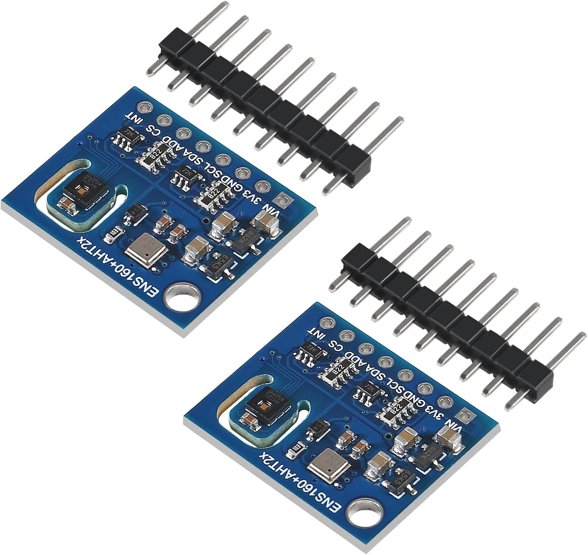
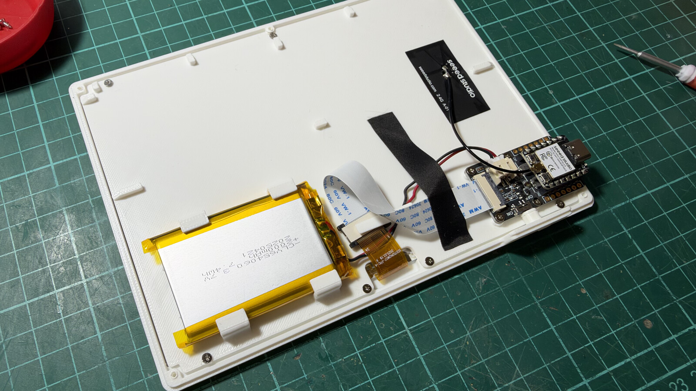
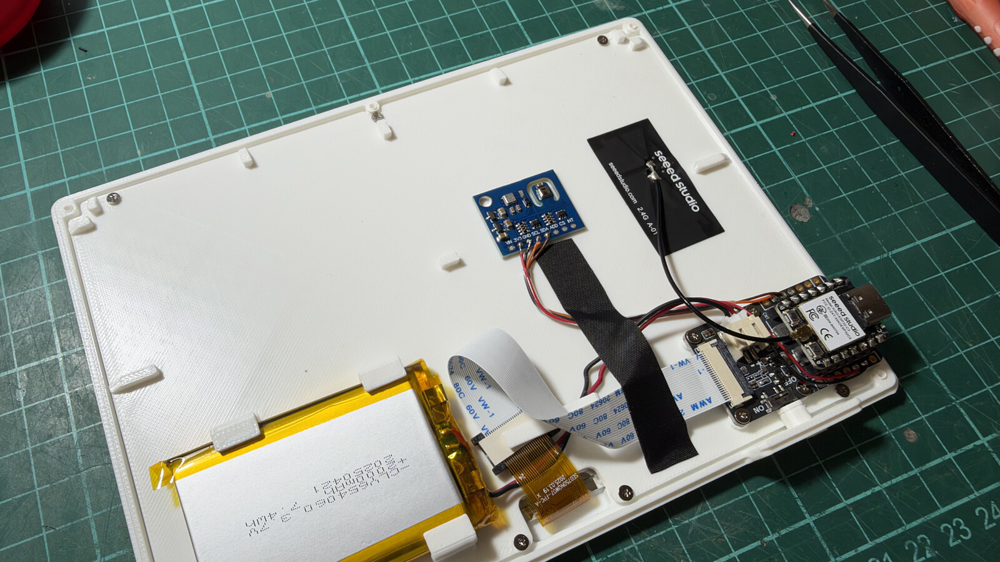
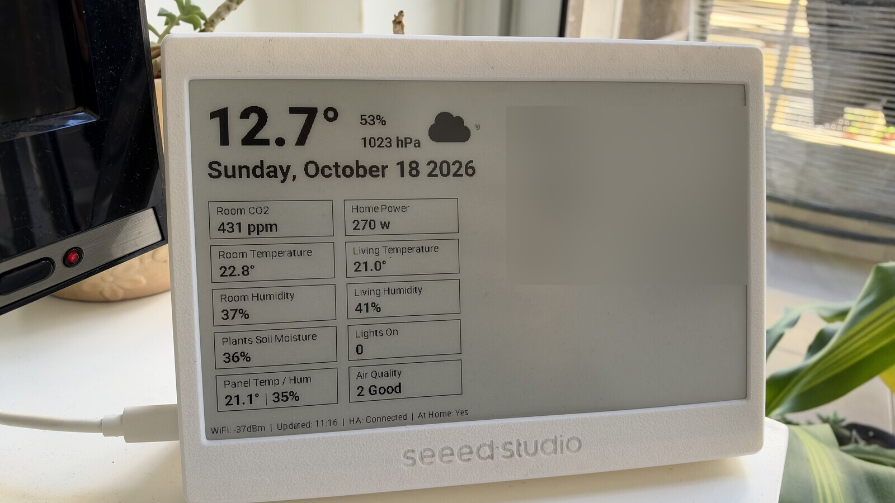

I am always adding something else to my Home Assistant network. A few weeks ago, I received two ENS160+AHT21 modules. These are small boards that combine the ScioSense [ENS160](../assets/files/hack-your-hacked-devices-1/ENS160-Datasheet.pdf) multi-gas sensor and the [AHT21](../assets/files/hack-your-hacked-devices-1/aht21_datasheet.pdf) temperature and humidity sensor. I bought them because of the ENS160: it picks up VOCs like ethanol and toluene, plus other gases like hydrogen and NO2, and gives you an Air Quality Index, TVOC, and eCO2.



My first idea was to hook it to a Wemos D1 and leave it somewhere in the living room. But I already have a big fleet of sensors, Arduinos, and ESPs hanging around the house, and every new one is another Wi-Fi client and another switching power supply close to my ham radio setup. So instead I decided to hack an already-hacked device: the [XIAO 7.5" ePaper Panel from Seeed Studio](https://www.seeedstudio.com/XIAO-7-5-ePaper-Panel-p-6416.html). I had already replaced its stock firmware with ESPHome, so it pulls everything it shows from Home Assistant.



The panel currently shows some cards I use daily: calendar, sensors, time, date, and weather. It runs on a [XIAO ESP32-C3](https://www.seeedstudio.com/Seeed-XIAO-ESP32C3-p-5431.html), so connecting the module is easy: 3V3, GND, SDA, SCL.



Thanks to ESPHome, the coding part is very easy. It barely feels like coding. You need the I2C bus, the AHT21 ([ESPHome handles it with the AHT10 platform, AHT20 variant](https://esphome.io/components/sensor/aht10/)), and the ENS160. If your config already has a `sensor:` section, add these under it instead of creating a new one.

```yaml
i2c:
  sda: GPIO6   # D4
  scl: GPIO7   # D5
  scan: true

sensor:
  # AHT21 works with the AHT20 variant
  - platform: aht10
    variant: AHT20
    update_interval: 60s
    temperature:
      name: "Panel Temperature"
      id: panel_temp
    humidity:
      name: "Panel Humidity"
      id: panel_humidity

  # ENS160: ESPHome defaults to 0x52; ENS160+AHT21 combo boards use 0x53.
  # Readings unavailable for ~1 h on the very first power-up, ~3 min after
  # every subsequent power-up/reboot.
  - platform: ens160_i2c
    address: 0x53
    update_interval: 60s
    eco2:
      name: "Panel eCO2"
      id: panel_eco2
    tvoc:
      name: "Panel TVOC"
      id: panel_tvoc
    aqi:
      name: "Panel Air Quality Index"
      id: panel_aqi
      on_value:
        - component.update: panel_aqi_rating
    compensation:
      temperature: panel_temp
      humidity: panel_humidity

text_sensor:
  # ENS160 AQI is the UBA scale, 1-5.
  - platform: template
    name: "Panel Air Quality Rating"
    id: panel_aqi_rating
    update_interval: never   # updated by panel_aqi on_value, so it never lags
    lambda: |-
      if (!id(panel_aqi).has_state() || std::isnan(id(panel_aqi).state)) {
        return {"Not Available"};
      }
      switch ((int) id(panel_aqi).state) {
        case 1: return {"Excellent"};
        case 2: return {"Good"};
        case 3: return {"Moderate"};
        case 4: return {"Poor"};
        case 5: return {"Unhealthy"};
        default: return {"Not Available"};
      }
```

Be patient the first time you power it on. The ENS160 needs about an hour before it reports anything, and around 3 minutes after every reboot after that.



The ENS160 has tiny heaters inside, and it sits right next to the AHT21 on the same board. Some users reported that the temperature will probably read a bit high. Check it against another sensor and add an offset filter if you need to, I'm unsure how far off are the temperature readings right now, it doesn't feel like it is too much to be honest. Also, this panel is designed to run on battery with deep sleep and a refresh every few hours. That does not work here because the ENS160 needs around 3 minutes after every wake-up before it reports anything. Keep the panel on USB power and disable deep sleep.

I feel this is a cleaner way to keep deploying more sensors around the house without physically adding more boards, Wi-Fi clients, and electrical noise.